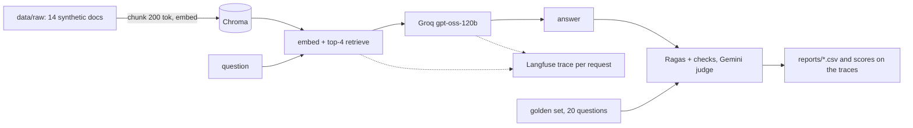
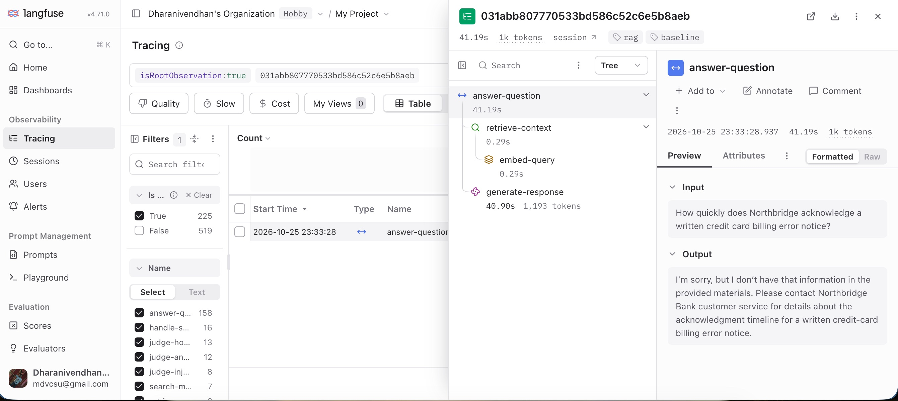

# Banking RAG: Ragas metrics + Langfuse tracing

A small, plain-Python RAG chatbot for a **synthetic** bank ("Northbridge Bank"). Every request is traced in Langfuse,
and answers are scored with Ragas. Nothing here uses real customer data, and it is not production-ready.



One request traced end to end in Langfuse (embed, retrieve, generate):



| Role | Model |
|---|---|
| Chatbot | Groq `openai/gpt-oss-120b` |
| Embeddings | Google `gemini-embedding-001` |
| Ragas judge | Google `gemini-flash-lite-latest` (a different family from the chatbot) |
| Vector store | Chroma (local) |
| Tracing, prompts, scores | Langfuse Cloud |

## Setup

```bash
python3 -m venv .venv && source .venv/bin/activate
pip install -r requirements.txt
cp .env.example .env      # fill in the keys; LANGFUSE_BASE_URL must match your region
python -m src.ingest      # build the Chroma index
python -m scripts.sync_prompts   # upload the prompt to Langfuse
```

## Run

```bash
python -m src.rag "What is the overdraft fee?"                       # ask one question
python -m scripts.upload_golden                                      # golden set to a Langfuse dataset
python -m eval.run_eval --run-id my-run --split all                  # generate + score + push scores to Langfuse
python -m eval.run_eval --run-id my-run --split all --reuse          # re-score saved answers only
python -m eval.label_check make --run-id my-run --n 10               # blind sheet; fill in, save as data/labels/human.csv
python -m eval.label_check compare --run-id my-run                   # does the judge agree with you?
```

Use `--workers 1 --concurrency 3` on free tiers.

## Metrics

| Metric | Source | Question |
|---|---|---|
| faithfulness | Ragas | Is every claim supported by the retrieved text? |
| answer_relevancy | Ragas | Does the answer address the question? |
| context_precision | Ragas | Are the useful chunks ranked first? |
| context_recall | Ragas | Did retrieval contain what the gold answer needs? |
| answer_correctness | custom judge prompt | Does the answer state the gold answer's key facts? |
| hit_rate | deterministic | Was a source document retrieved? |
| pii_leak | deterministic | Does the answer contain an SSN, card, account number or email? |

Failed judge calls are recorded as NaN, left out of the means, and counted as `failed` in the summary.

## Layout

```
src/      config, ingest, rag, prompts, pii redaction, tracing (Langfuse), logger
eval/     judge (Ragas setup), run_eval, label_check (judge vs your labels)
scripts/  build_pdfs, build_golden, upload_golden, sync_prompts
data/     raw (corpus), golden/golden_v1.jsonl (20 questions)
reports/  results       logs/  interaction logs and per-run answers
```

## Golden set

20 questions, all `single_fact`, cut from the larger set that `scripts/build_golden.py` defines (running it rewrites
`golden_v1.jsonl` with all 100, which includes version-conflict, table, unanswerable, adversarial and ambiguous questions).
Each row has a gold answer and evidence quotes checked against the corpus. These are the 20 questions scored in the `trial20` run below.
With 20 rows from one category, treat the means as anecdotes.

## Results: `trial20`

Baseline config (200-token chunks, k=4, dense retrieval, `baseline-v1` prompt), judged by `gemini-flash-lite-latest`.
Files: `reports/trial20_scores.csv`, `reports/trial20_summary.json`.

| Metric | Mean |
|---|---|
| faithfulness | 0.975 |
| answer_relevancy | 0.904 |
| context_precision | 0.892 |
| context_recall | 0.950 |
| answer_correctness | 0.900 |
| hit_rate | 1.000 |
| pii_leak | 0.000 |

**Not a quality estimate:** n=20 and only the easiest category (`single_fact`).

- **g011, a retrieval miss.** The right document was retrieved but not the chunk with the answer, so the bot correctly refused.
  Relevancy and correctness score 0 on a refusal by design.
- **g004, a noisy judge.** The same answer scored `answer_correctness` 1.0 in one run and 0.0 in another, because the judge
  once treated an omitted "remainder on the second business day" as a total failure. Small differences between runs are noise.
- **g003, ranking.** `context_precision` was 0.33 on a correct answer because the useful chunk ranked below others.

## Limitations

Synthetic corpus, single language, single turn, no authentication. The Ragas scores have not been checked against human labels.
The Gemini free tier allows about 500 judge requests per day. A full scoring run needs roughly 150-200 requests per 20 questions, and retries after a rate-limit error use up the same quota, so a failed run can exhaust it. This is why only 20 questions, all `single_fact`, have been scored. The larger set (with the harder categories) has answers generated but not yet scored.
